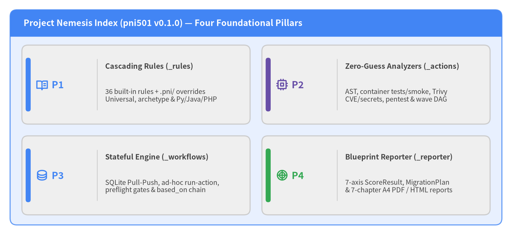
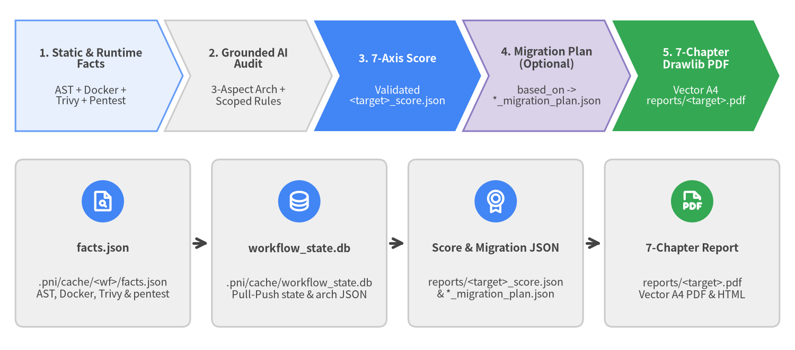

# pni501 (Project Nemesis Index) — Architecture & Mechanism Specification

**Package**: `pni501` (`v0.1.0` | `import pni` / CLI: `pni`) | **Languages**: `Python`, `Java`, `PHP` | **Theme**: Google Style (`en`) | **Architecture**: AI-Native Deterministic Software Health & Migration Engine

**Project Nemesis Index (`pni501`)** is an AI-native software health evaluation, security auditing, and migration planning framework supporting **`Python`**, **`Java`**, and **`PHP`** repositories. By uniting **cascading multi-language engineering rules** (`_rules`), **zero-hallucination static, container, security, and penetration analyzers** (`_actions`), a **SQLite-backed stateful Pull-Push workflow engine** (`_workflows`), and **blueprint-driven Drawlib visual reporting** (`_reporter`), `pni501` eliminates LLM metric and path hallucinations while producing actionable 7-axis health scores, topological migration plans, and publication-grade 7-chapter A4 PDF reports.

<figure class="drawlib-image">
  
  <figcaption class="drawlib-caption">Core Architectural Pillars of pni501 (Project Nemesis Index v0.1.0)</figcaption>
</figure>

---

## Executive Overview: Hybrid Deterministic + Cognitive Auditing & Migration

Purely LLM-driven code reviews suffer from non-deterministic counting errors, invented module paths, skipped checklist categories, and complete blindness to runtime container behavior, dependency CVEs, and live HTTP attack surfaces. Conversely, purely static linters cannot evaluate domain boundary cohesion, aspect-separated system architecture, or phased modernization trade-offs.

`pni501` (`v0.1.0`) bridges both worlds across **`Python`**, **`Java`**, and **`PHP`** through **`36` built-in cascading rules** (`common/`, `python/`, `java/`, `php/`), **`21` reusable composite actions**, and **`12` canonical `PrimitiveType`s** orchestrated in a dual-track audit-to-migration pipeline:

- **Programmatic Multi-Modal Fact Extraction (`6` Deterministic Primitives)**: `pni` executes `project_inspect`, polyglot `ast_analyze` (Python `ast` + `ast-grep-py` for Java/PHP), isolated Docker `run_check` (unit tests, coverage, HTTP smoke checks), socketless Trivy `security_scan` (SCA CVEs, IaC misconfigurations, leaked secrets), loopback `pytest` + `httpx` `web_pentest`, and topological `migration_analyze`—persisting exact telemetry into `.pni/cache/<workflow_id>/facts.json` and `.pni/cache/workflow_state.db`.
- **Schema-Enforced Cognitive Audit, Chained Migration & Visual Reporting (`6` AI/Report Primitives)**: Guided step-by-step via `workflow_state.db`, the Code AI Agent loads scoped rules (`load_rules`), records path-verified 3-aspect architecture (`record_architecture` -> `architecture.json`), evaluates rule compliance (`ai_interpret`), emits a 7-axis `ScoreResult` (`reports/<target>_score.json`), optionally chains a `based_on` migration workflow into a validated `MigrationPlanResult` (`reports/<target>_migration_plan.json`), and compiles a 7-chapter **Drawlib visual report** (`reports/<target>.pdf` and optional HTML).

<figure class="drawlib-image">
  
  <figcaption class="drawlib-caption">End-to-End Dual-Track Execution Pipeline: From Deterministic Facts to 7-Axis Score, Optional Migration Plan & 7-Chapter Drawlib PDF</figcaption>
</figure>

