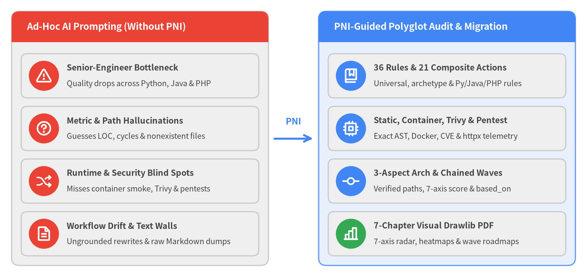
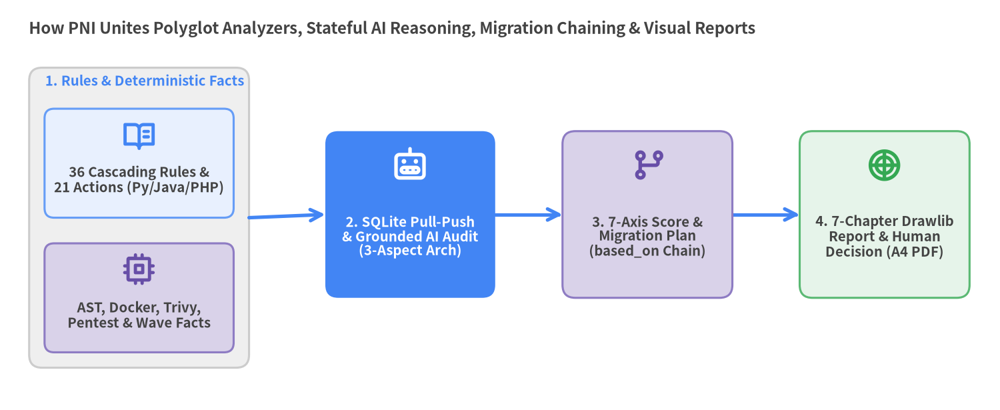

# 1. Background, Problem Statement & The PNI Approach

Modernizing legacy and evolving software across **`Python`**, **`Java`**, and **`PHP`** remains one of the highest-leverage—and highest-risk—challenges in engineering organizations, yet applying Code AI Agents reliably still bottlenecks on senior human supervision unless polyglot standards, static and runtime telemetry, stateful workflows, and visual reporting are unified into a single deterministic harness.

<figure class="drawlib-image">
  
  <figcaption class="drawlib-caption">The AI Modernization Gap: Ad-Hoc Prompting vs. Codified PNI Polyglot Audit & Migration Rigor</figcaption>
</figure>

---

## 1.1 Background: Multi-Language Legacy Modernization in the Generative AI Era

Across enterprise backends, SaaS platforms, and internal developer tooling, **legacy modernization spans heterogeneous language ecosystems—most notably `Python`, `Java`, and `PHP`**. Engineering teams routinely inherit Python services with flat script layouts and untyped boundaries, Java Spring or servlet applications with tangled package dependencies and aging Maven/Gradle trees, or PHP monoliths (`Laravel`, `WordPress`, or custom Composer/vanilla codebases) carrying raw SQL/template sinks and sparse automated tests. Before any team can safely refactor, re-architect, or migrate such repositories, engineers need an objective, reproducible baseline of structural health, runtime behavior, and security posture.

While **Code AI Agents** have dramatically accelerated code reading and transformation, unconstrained ad-hoc prompting suffers from four systemic failure modes:

1. **Senior-Engineer Prompt Bottleneck Across Ecosystems**: Crafting prompts that simultaneously enforce universal architecture principles (OWASP ASVS, OpenSSF supply-chain hygiene, Twelve-Factor readiness, CLI ergonomics) alongside language- and framework-specific idioms (`FastAPI`, `Spring Boot`, `Laravel`, `WordPress`) requires deep staff-level expertise on every run.
2. **Quantitative & Structural Hallucinations**: When asked to inspect a repository directly in chat, LLMs routinely guess LOC counts, fabricate type-annotation or generic coverage ratios, overlook cyclic dependency DAGs, and cite module paths that do not exist in the workspace.
3. **Runtime, Vulnerability & Penetration-Testing Blind Spots**: Static prompt-only reviews never verify whether tests actually pass inside a clean container, what line/branch coverage is achieved, whether `Trivy` flags critical CVEs, IaC misconfigurations, or hardcoded secrets, or whether live HTTP endpoints resist auth-bypass, SQLi/XSS, and SSRF probes under dynamic penetration testing.
4. **Workflow Drift, Ungrounded Migration Plans & Wall-of-Text Overload**: In long chat sessions, agents skip audit dimensions, propose risky "big-bang" rewrites disconnected from the real dependency graph, and dump thousands of lines of raw Markdown that overwhelm human reviewers.

---

## 1.2 The PNI Approach: Four Pillars of Deterministic AI Auditing & Migration

**Project Nemesis Index (`pni501` `v0.1.0`)** closes this gap by codifying senior engineering methodology into a deterministic CLI and SQLite state machine that guides any Code AI Agent (`Claude Code`, `Gemini CLI`, `Cursor`, `Antigravity`, etc.) from raw repository telemetry to a 7-axis health audit, an optional chained migration plan, and a 7-chapter visual report:

<figure class="drawlib-image">
  
  <figcaption class="drawlib-caption">The Four-Step PNI Approach: Orchestrating Polyglot Analyzers, Grounded AI Audits, Chained Migration Plans & 7-Chapter Visual Reports</figcaption>
</figure>

### 1. Cascading Multi-Language Rules, Actions & Workflows (`_rules` & `_actions`)
Instead of relying on ad-hoc prompts, `pni501` ships **`36` built-in engineering rules** across `common/`, `python/`, `java/`, and `php/`—covering universal architecture, security (`OWASP ASVS` + vulnerability/attack-surface standards), OpenSSF supply-chain governance, Twelve-Factor cloud-native readiness, CLI ergonomics, library hygiene, migration planning, and framework best practices (`FastAPI`, `Spring Boot`, `Laravel`, `WordPress`)—paired with **`21` composite actions** that expand into **`12` canonical `PrimitiveType`s**. Every built-in asset supports non-destructive `.pni/` local cascading overrides per repository.

### 2. Zero-Hallucination Static, Container, Security & Pentest Analyzers
Anything countable, executable, or structurally provable is measured programmatically and cached in `.pni/cache/<workflow_id>/facts.json`:
- **Polyglot Static & Manifest Inspection (`project_inspect`, `ast_analyze`)**: Parses `pyproject.toml`, `pom.xml`/`build.gradle`, `composer.json`, lockfiles, CI/governance metadata, Python `ast`, and `ast-grep-py` syntax trees for `Java` and `PHP` to extract exact `module_inventory`, LOC, typing/generics ratios, cyclomatic complexity, API endpoints, security sinks, and cyclic import graphs.
- **Isolated Runtime, Security & Loopback Pentest Execution (`run_check`, `security_scan`, `web_pentest`)**: Executes unit suites, coverage collection, and HTTP smoke probes in isolated containers; runs socketless `Trivy` scans (`-- vuln,misconfig,secret`) with zero Docker-daemon exposure; and runs target-tailored `pytest` + `httpx` Web penetration tests against loopback containers (enforcing fail-closed preflight checks on `.pni/pentests/<target>/`).
- **Topological Migration Wave Analysis (`migration_analyze`)**: Computes strongly connected dependency cycles, external boundary touchpoints, and bottom-up leaf-to-entrypoint `refactoring_waves` directly from the verified import DAG.

### 3. Stateful Pull-Push Execution, 3-Aspect Grounded Architecture & `audit -> migration` Chaining (`_workflows`)
`pni workflows` drives the agent through a SQLite state machine (`.pni/cache/workflow_state.db`) via `start`, `get-action`, and `push-action` (alongside zero-prep `run-action` for single-step iteration):
- **3-Aspect Grounded Architecture Recording (`record_architecture`)**: Before scoring, the agent records system comprehension across three explicit aspects—`purpose_and_stack`, `layers_and_modules`, and `flows_and_state`—while PNI validates every cited file and module path against `module_inventory` before persisting `.pni/cache/<workflow_id>/architecture.json`.
- **7-Axis Health Scoring (`emit_score`)**: The agent synthesizes rule compliance and prioritized findings into a schema-validated `ScoreResult` (`reports/<target>_score.json`) across **7 core engineering axes**: `architecture`, `code_quality`, `typing`, `testing`, `dependencies`, `security`, and `documentation`.
- **Prerequisite-Gated Migration Chaining (`based_on` -> `emit_migration_plan`)**: Migration workflows (`category: migration`) declare `based_on: <audit_workflow_id>`, failing closed unless a `COMPLETED` audit run exists in `workflow_state.db`, then inherit verified As-Is audit facts and architecture records to emit a path-validated `MigrationPlanResult` (`reports/<target>_migration_plan.json`).

### 4. Blueprint-Driven 7-Chapter Visual Drawlib Reports (`_reporter`)
To minimize human cognitive load during technical triage and architecture review, `_reporter` generates a deterministic JSON blueprint (`blueprint.json` or `migration_blueprint.json`) that guides the authoring of a **7-chapter Drawlib `doc` report** (`00_cover.md` + `01..06` under `reports_src/<target>_src/`). Combining executive `KpiCards`, 7-axis `RadarChart`s, 2D module `HeatmapChart`s, architectural risk `HeatmapOverlay`s, and phased `P0`–`P2` / wave `Roadmap`s, `pni report build` compiles crisp print-ready A4 vector PDFs (`reports/<target>.pdf`) and HTML deliverables with zero broken links.
