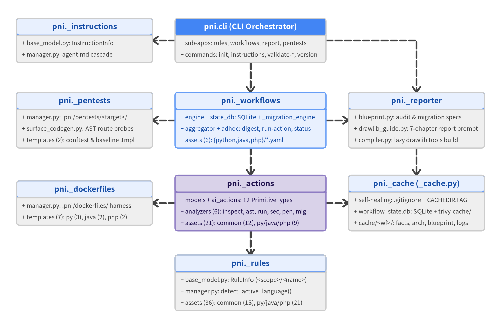
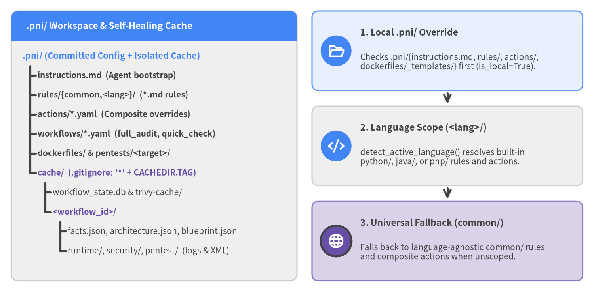

# 2. High-Cohesion Domain Architecture & Cascade Resolution

`pni501` organizes its implementation under `src/pni/` around **seven vertical domain packages** (`_workflows`, `_actions`, `_reporter`, `_rules`, `_pentests`, `_dockerfiles`, and `_instructions`), a self-healing cache utility (`_cache.py`), and a thin Typer + Rich entrypoint (`cli.py`). Each domain colocates its Pydantic v2 schemas, resolution or execution logic, and built-in `.md`, `.yaml`, `.dockerfile`, or `.tmpl` assets—preserving a strict module-level Directed Acyclic Graph (`circular_dependencies = []`) across all `107` Python source files.


<figure class="drawlib-image" style="text-align: center;">
  
  <figcaption class="drawlib-caption">High-Cohesion Domain Package Hierarchy and Module-Level Dependency DAG in src/pni/</figcaption>
</figure>

<details class="drawlib-code-details">
<summary>Source Code</summary>

```python
from drawlib.canvas import save, setup
from drawlib.diagrams.class_diagram import ClassDiagram, ClassNode
from drawlib.styles import Colors, Styles

setup(width=166, height=106, dpi=150)

diagram = ClassDiagram(
    node_style=Styles.Neutral.patch(text_size=10.0),
    header_style=Styles.PrimaryNeutral.patch(text_size=10.5),
    edge_style=Styles.DarkBold,
    edge_text_style=Styles.PrimaryBold.patch(text_size=10.0),
)

inst_node = ClassNode(
    "pni._instructions",
    width=45.0,
    header_height=5.6,
    row_height=3.8,
)
inst_node.add_attribute("base_model.py", "InstructionInfo")
inst_node.add_attribute("manager.py", "agent.md cascade")
diagram.add(inst_node, xy=(28.0, 92.5))

cli_node = ClassNode(
    "pni.cli (CLI Orchestrator)",
    width=50.0,
    header_height=5.6,
    row_height=3.8,
    header_style=Styles.PrimaryFlat.patch(text_color=Colors.White, text_size=10.5),
)
cli_node.add_attribute("sub-apps", "rules, workflows, report, pentests")
cli_node.add_attribute("commands", "init, instructions, validate-*, version")
diagram.add(cli_node, xy=(83.0, 92.5))

pentest_node = ClassNode(
    "pni._pentests",
    width=45.0,
    header_height=5.6,
    row_height=3.8,
)
pentest_node.add_attribute("manager.py", ".pni/pentests/<target>/")
pentest_node.add_attribute("surface_codegen.py", "AST route probes")
pentest_node.add_attribute("templates (2)", "conftest & baseline .tmpl")
diagram.add(pentest_node, xy=(28.0, 66.0))

wf_node = ClassNode(
    "pni._workflows",
    width=50.0,
    header_height=5.6,
    row_height=3.8,
    style=Styles.PrimaryNeutral.patch(text_size=10.0),
)
wf_node.add_attribute("engine + state_db", "SQLite + _migration_engine")
wf_node.add_attribute("aggregator + adhoc", "digest, run-action, status")
wf_node.add_attribute("assets (6)", "{python,java,php}/*.yaml")
diagram.add(wf_node, xy=(83.0, 66.0))

rep_node = ClassNode(
    "pni._reporter",
    width=45.0,
    header_height=5.6,
    row_height=3.8,
)
rep_node.add_attribute("blueprint.py", "audit & migration specs")
rep_node.add_attribute("drawlib_guide.py", "7-chapter report prompt")
rep_node.add_attribute("compiler.py", "lazy drawlib.tools build")
diagram.add(rep_node, xy=(138.0, 66.0))

docker_node = ClassNode(
    "pni._dockerfiles",
    width=45.0,
    header_height=5.6,
    row_height=3.8,
)
docker_node.add_attribute("manager.py", ".pni/dockerfiles/ harness")
docker_node.add_attribute("templates (7)", "py (3), java (2), php (2)")
diagram.add(docker_node, xy=(28.0, 38.5))

act_node = ClassNode(
    "pni._actions",
    width=50.0,
    header_height=5.6,
    row_height=3.8,
    style=Styles.SecondaryNeutral.patch(text_size=10.0),
    header_style=Styles.SecondaryNeutral.patch(text_size=10.5),
)
act_node.add_attribute("models + ai_actions", "12 PrimitiveTypes")
act_node.add_attribute("analyzers (6)", "inspect, ast, run, sec, pen, mig")
act_node.add_attribute("assets (21)", "common (12), py/java/php (9)")
diagram.add(act_node, xy=(83.0, 38.5))

cache_node = ClassNode(
    "pni._cache (_cache.py)",
    width=45.0,
    header_height=5.6,
    row_height=3.8,
)
cache_node.add_attribute("self-healing", ".gitignore + CACHEDIR.TAG")
cache_node.add_attribute("workflow_state.db", "SQLite + trivy-cache/")
cache_node.add_attribute("cache/<wf>/", "facts, arch, blueprint, logs")
diagram.add(cache_node, xy=(138.0, 38.5))

rules_node = ClassNode(
    "pni._rules",
    width=50.0,
    header_height=5.6,
    row_height=3.8,
)
rules_node.add_attribute("base_model.py", "RuleInfo (<scope>/<name>)")
rules_node.add_attribute("manager.py", "detect_active_language()")
rules_node.add_attribute("assets (36)", "common (15), py/java/php (21)")
diagram.add(rules_node, xy=(83.0, 12.0))

diagram.connect(cli_node, inst_node, "dependency", start_side="left", end_side="right")
diagram.connect(cli_node, wf_node, "dependency", start_side="bottom", end_side="top")
diagram.connect(cli_node, rep_node, "dependency", start_side="right", end_side="top")
diagram.connect(wf_node, pentest_node, "dependency", start_side="left", end_side="right")
diagram.connect(wf_node, rep_node, "dependency", start_side="right", end_side="left")
diagram.connect(wf_node, act_node, "dependency", start_side="bottom", end_side="top")
diagram.connect(act_node, docker_node, "dependency", start_side="left", end_side="right")
diagram.connect(act_node, cache_node, "dependency", start_side="right", end_side="left")
diagram.connect(rep_node, cache_node, "dependency", start_side="bottom", end_side="top")
diagram.connect(act_node, rules_node, "dependency", start_side="bottom", end_side="top")

diagram.draw(xy=(0.0, 0.0))
save()
```

</details>


---

## 2.1 High-Cohesion Domain Package Design (`src/pni/`)

Traditional CLI codebases often slice code horizontally—scattering Pydantic models across `models/`, YAML/Markdown loaders across `config/`, subprocess runners across `executors/`, and static files across `templates/`. Modifying a single audit capability then forces synchronized edits across four disconnected directories and inflates context overhead for both human maintainers and AI coding agents.

`pni501` instead organizes `src/pni/` into **self-contained vertical domain packages**. Top-level `src/pni/__init__.py` exports only package identity constants (`LIB_NAME = "pni501"`, `LIB_VERSION = "0.1.0"`, and `__version__`), while every subsystem colocates its schemas, orchestration modules, and packaged templates inside its own bounded directory:

| Package / Module | Core Python Modules | Key Schemas & Responsibilities | Packaged Built-in Assets |
| :--- | :--- | :--- | :--- |
| **`cli.py`** | `cli.py` | Typer root `app` + 4 sub-apps (`rules`, `workflows`, `report`, `pentests`) and root commands (`init`, `instructions`, `validate-score`, `validate-migration-plan`, `version`) | Rich CLI help epilog & bootstrap prompts |
| **`_workflows/`** | `base_model.py`, `state_db.py`, `manager.py`, `engine.py`, `_migration_engine.py`, `aggregator.py`, `adhoc.py`, `inspector.py` | `WorkflowDefinition`, `WorkflowFactsBundle`, `WorkflowStateDB`, `CompiledAuditDigest`; stateful pull/push engine, ad-hoc `run-action`, and run history inspection | `6` starter workflows: `{python,java,php}/{full_audit,quick_check}.yaml` |
| **`_actions/`** | `base_model.py`, `manager.py`, `ai_actions.py`, `project_inspect.py`, `_repo_governance.py`, plus `ast_analyze/`, `runtime_check/`, `security_scan/`, `pentest/`, `migration_analyze/` | `PrimitiveType` (`12`), `ScoreResult`, `ArchitectureRecord`, `MigrationPlanResult`, and 6 deterministic fact extractors (`ast_analyze/` houses `base/` + `python/`, `java/`, `php/` checkers) | `21` composite YAML actions: `common/` (`12`), `python/` (`3`), `java/` (`3`), `php/` (`3`) |
| **`_reporter/`** | `base_model.py`, `blueprint.py`, `migration_blueprint.py`, `drawlib_guide.py`, `compiler.py` | `ReportBlueprint`, `ReportScaffoldResult`, `ReportBuildResult`; pre-sorts audit/migration chapter blueprints and lazily imports `drawlib.tools` in `compiler.py` | 7-chapter Drawlib `doc` scaffolding & chapter linter |
| **`_rules/`** | `base_model.py`, `manager.py` | `RuleInfo`, `SUPPORTED_LANGUAGES = ("python", "java", "php")`, `detect_active_language()`, and `<scope>/<name>` cascade resolution | `36` Markdown files: `common/` (`15`), `python/` (`7`), `java/` (`6`), `php/` (`8`) |
| **`_pentests/`** | `manager.py`, `surface_codegen.py` | Materializes and validates target-scoped `pytest + httpx` Web penetration suites in `.pni/pentests/<target>/`, generating `test_target_surface.py` from `AstFacts.api_endpoints` | `2` probe templates: `conftest.py.tmpl`, `test_baseline_http.py.tmpl` |
| **`_dockerfiles/`** | `manager.py` | Resolves `.pni/dockerfiles/_templates/` overrides or built-in container harnesses into `.pni/dockerfiles/` alongside an isolated `.dockerignore` | `7` templates: `python/{pip,poetry,uv}`, `java/{gradle,maven}`, `php/{composer,raw}.dockerfile` |
| **`_instructions/`** | `base_model.py`, `manager.py` | `InstructionInfo`; resolves `.pni/instructions.md` overrides over built-in agent bootstrap instructions | `agent.md` |
| **`_cache.py`** | `_cache.py` | Self-healing `.pni/cache/` initializer (`ensure_cache_dir`, `ensure_cache_parent`) and workspace-safe path resolvers (`normalize_target_subpath`) | Auto-generated `.pni/cache/.gitignore` (`*`) and `CACHEDIR.TAG` |

Colocating Python modules and static assets inside each package makes `BUILTIN_*_DIR = Path(__file__).resolve().parent` deterministic in editable installs and packaged wheels alike.

---

## 2.2 Module-Level Dependency Hierarchy & Lazy Tooling Isolation

Every import across `src/pni/` forms a strict **module-level Directed Acyclic Graph**—verified continuously by `pni501` running `ast_analyze` on its own `src/pni/` tree (`107` files, `circular_dependencies = []`):

1. **CLI Orchestrator (`src/pni/cli.py`)**: Parses user arguments, formats Rich tables and Markdown panels, and dispatches commands into `_workflows`, `_actions`, `_reporter`, `_rules`, `_pentests`, `_instructions`, and `_cache`. No internal module ever imports `pni.cli`.
2. **Stateful Workflow Orchestration (`src/pni/_workflows/`)**:
   - `engine.py` and `_migration_engine.py` coordinate SQLite persistence (`state_db.py`), preflight prerequisite gates (`based_on` audit completion and `.pni/pentests/` readiness), deterministic step execution, path-grounding verification, and `aggregator.py` score synthesis (`compile_workflow_digest`).
   - `adhoc.py` (`pni workflows run-action`) executes single workflow actions directly in memory with zero SQLite preparation, while `inspector.py` powers `pni workflows status` and `inspect-action` without exposing raw database queries.
3. **Action Subsystems & Supporting Harnesses (`_actions/`, `_reporter/`, `_pentests/`, `_dockerfiles/`)**:
   - Pure Pydantic data models in `_actions/base_model.py`, `_actions/ast_analyze/models.py`, and `_actions/migration_analyze/models.py` act as shared Leaf Schema contracts consumed cleanly by `_reporter/blueprint.py`, `_reporter/migration_blueprint.py`, and `_pentests/surface_codegen.py` without triggering cyclic runner imports.
   - Execution runners in `_actions/runtime_check/`, `_actions/security_scan/`, and `_actions/pentest/` delegate container harness setup to `_dockerfiles` and probe scaffolding to `_pentests`, while `_actions/ai_actions.py` delegates report prompt rendering to `_reporter/drawlib_guide.py`.
   - `_reporter/compiler.py` loads `drawlib.tools` **lazily** via `importlib.import_module("drawlib.tools")` behind a typed `_DrawlibToolsProtocol`, keeping `pni rules`, `pni workflows`, and `pni init` fast without importing Matplotlib/Cairo rendering stacks until `pni report` is invoked.
4. **Zero-Sibling Leaf Foundations (`_rules/`, `_instructions/`, `_cache.py`)**: Import zero sibling `pni._*` packages, providing pure language detection, Markdown cascade lookup, and path-traversal-guarded cache management across the workspace.

---

## 2.3 `.pni/` Workspace Layout & Three-Tier Cascade Resolution

Running `pni init [--lang/-l <python|java|php>] [--force/-f]` invokes `init_project()` in `src/pni/cli.py`, seeding a transparent `.pni/` configuration directory for the detected language while initializing the self-healing `.pni/cache/` hierarchy.


<figure class="drawlib-image" style="text-align: center;">
  
  <figcaption class="drawlib-caption">.pni/ Workspace & Self-Healing Cache Hierarchy Alongside Three-Tier Cascade Resolution</figcaption>
</figure>

<details class="drawlib-code-details">
<summary>Source Code</summary>

```python
from drawlib.canvas import save, setup
from drawlib.icons import phosphor
from drawlib.smartarts import CardList, Panel, TreeNode
from drawlib.styles import Styles

setup(width=158, height=78, dpi=150)

left_panel = Panel(
    ".pni/ Workspace & Self-Healing Cache",
    header_variant="filled",
    style=Styles.Neutral.patch(shape_r=2.0),
    header_style=Styles.PrimaryFlat,
    text_style=Styles.WhiteBold.patch(text_size=11.0),
)
left_panel.draw(xy=(3.0, 3.0), width=76.0, height=72.0)

root = TreeNode(
    ".pni/ (Committed Config + Isolated Cache)",
    text_style=Styles.PrimaryBold.patch(text_size=10.5),
    line_style=Styles.DarkBold,
    line_horizontal_margin=2.0,
    line_horizontal_length=2.2,
    line_vertical_margin=5.2,
)
root.add("instructions.md  (Agent bootstrap)", text_style=Styles.DarkBold.patch(text_size=10.0))
root.add("rules/{common,<lang>}/  (*.md rules)", text_style=Styles.DarkBold.patch(text_size=10.0))
root.add("actions/*.yaml  (Composite overrides)", text_style=Styles.DarkBold.patch(text_size=10.0))
root.add("workflows/*.yaml  (full_audit, quick_check)", text_style=Styles.DarkBold.patch(text_size=10.0))
root.add("dockerfiles/ & pentests/<target>/", text_style=Styles.DarkBold.patch(text_size=10.0))
cache_dir = root.add(
    "cache/  (.gitignore: '*' + CACHEDIR.TAG)",
    text_style=Styles.SecondaryBold.patch(text_size=10.0),
)
cache_dir.add("workflow_state.db & trivy-cache/", text_style=Styles.Dark.patch(text_size=10.0))
wf_cache = cache_dir.add("<workflow_id>/", text_style=Styles.SecondaryBold.patch(text_size=10.0))
wf_cache.add("facts.json, architecture.json, blueprint.json", text_style=Styles.Dark.patch(text_size=10.0))
wf_cache.add("runtime/, security/, pentest/  (logs & XML)", text_style=Styles.Dark.patch(text_size=10.0))
root.draw(xy=(6.0, 63.0))

cascade_cards = CardList(
    style=Styles.PrimaryNeutral.patch(shape_r=1.8),
    text_style=Styles.DarkBold.patch(text_size=11.0),
    description_style=Styles.Dark.patch(text_size=10.0),
    badge_shape="circle",
    badge_style=Styles.PrimaryFlat,
    badge_text_style=Styles.WhiteBold.patch(text_size=10.5),
    icon_style=Styles.WhiteBold,
    direction="vertical",
    spacing=3.8,
    show_arrows=True,
    arrow_style=Styles.DarkBold,
)
cascade_cards.add(
    "1. Local .pni/ Override",
    "Checks .pni/{instructions.md, rules/, actions/,\ndockerfiles/_templates/} first (is_local=True).",
    icon=phosphor.folder_open,
)
cascade_cards.add(
    "2. Language Scope (<lang>/)",
    "detect_active_language() resolves built-in\npython/, java/, or php/ rules and actions.",
    style=Styles.Neutral.patch(shape_r=1.8),
    icon=phosphor.code,
)
cascade_cards.add(
    "3. Universal Fallback (common/)",
    "Falls back to language-agnostic common/ rules\nand composite actions when unscoped.",
    style=Styles.SecondaryNeutral.patch(shape_r=1.8),
    badge_style=Styles.SecondaryBold,
    icon=phosphor.globe,
)
cascade_cards.draw(xy=(83.0, 3.0), width=72.0, height=72.0)
save()
```

</details>


### Self-Healing Cache & Target-Scoped Workspace Artifacts

Rather than modifying the host project's root `.gitignore`, `src/pni/_cache.py` (`ensure_cache_dir()` and `ensure_cache_parent()`) makes `.pni/cache/` **self-healing**:

- **Automatic Git & Backup Exclusion**: Every write into `.pni/cache/` automatically guarantees the existence of `.pni/cache/.gitignore` (`*`) and a standard `CACHEDIR.TAG` signature (`8a477f597d28d172789f06886806bc55`), keeping SQLite databases, Trivy vulnerability DB caches (`trivy-cache/`), JUnit XML reports, and container logs out of Git status and backup archives even in uninitialized repositories.
- **Workflow-Isolated Ephemeral State (`.pni/cache/<workflow_id>/`)**: Each workflow writes its aggregated snapshot to `facts.json`, grounded 3-aspect architecture model to `architecture.json`, pre-sorted report specification to `blueprint.json` (or `migration_facts.json` and `migration_blueprint.json`), and raw stage artifacts into `runtime/`, `security/`, and `pentest/`.
- **Path-Guarded Multi-Target Harnesses (`.pni/dockerfiles/` & `.pni/pentests/`)**: `normalize_target_subpath()` rejects absolute paths and `..` traversal while mapping monorepo targets cleanly—for example, `targets.root: examples/php/legacy_shop_messy` maps to `.pni/dockerfiles/examples/php/legacy_shop_messy/Dockerfile` and `.pni/pentests/examples/php/legacy_shop_messy/`.

### Three-Tier Cascade & Language Resolution Rules

Teams can keep all seeded `.pni/` files (`37` files for Python, `36` for Java, `38` for PHP—excluding meta-guides `agent_instruction.md` and `workflow_guide.md` so `.pni/rules/` stays focused on project audit criteria) or delete unmodified files and retain only targeted overrides:

1. **Active Language Detection (`_rules/manager.py`)**: `detect_active_language(project_root)` inspects manifests in strict priority order—Python (`pyproject.toml`, `setup.py`, `requirements.txt`), Java (`pom.xml`, `build.gradle`, `build.gradle.kts`, `settings.gradle*`), PHP (`composer.json`, `wp-config*.php`, `artisan`, `phpunit.xml*`), TypeScript (`package.json`, `tsconfig.json`), and Go (`go.mod`)—before falling back to Java/PHP source-tree heuristics (`src/main/java`, `*.php`, `*.phtml`) and defaulting to `"python"`.
2. **Engineering Rules (`local > <lang> > common`)**: `list_rules()` merges `(scope, name)` candidates across built-in `src/pni/_rules/` and local `.pni/rules/` for `("common", active_lang)` (or all `SUPPORTED_LANGUAGES` with `--all`), preferring `.pni/rules/<scope>/<name>.md` (`is_local=True`). `get_rule_content()` resolves identifiers across hyphen/underscore normalization in four steps: exact `<scope>/<name>` -> `<active_lang>/<name>` -> `common/<name>` -> any matching rule name.
3. **Composite Actions (`local > <lang> > common`)**: `load_composite_action()` resolves `.pni/actions/<id>.yaml` (or scoped `.pni/actions/<scope>/<id>.yaml`) first, then built-in `<active_lang>/<id>.yaml` (enabling `uses: repo_structure_audit` to dispatch automatically to `python/`, `java/`, or `php/`), and finally `common/<id>.yaml`.
4. **Container Harnesses & Instructions**: `resolve_template_dockerfile()` prioritizes `.pni/dockerfiles/_templates/<lang>/<tool>.dockerfile` over built-in `src/pni/_dockerfiles/<lang>/<tool>.dockerfile` (with per-language fallback to `pip`, `maven`, or `composer`), while `get_instructions_info()` prioritizes `.pni/instructions.md` over `src/pni/_instructions/agent.md`.
