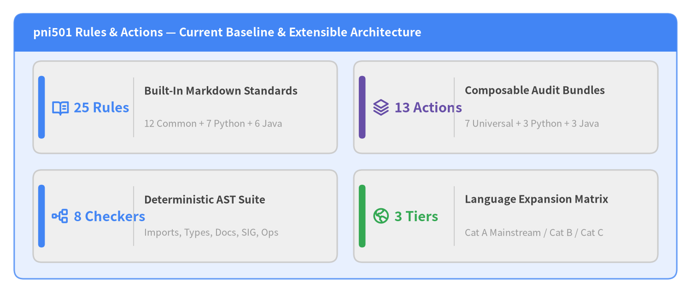
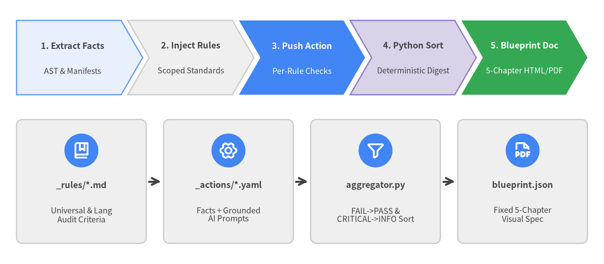

# pni501 Rules & Actions — Reference Catalog & Multi-Language Roadmap

**Package**: `pni501` (`import pni` / CLI: `pni`) | **Theme**: Google Style (`en`) | **Scope**: Built-In Standards, Actions & Expansion Plan

This specification provides the human-oriented engineering reference for **Rules (`_rules`)** and **Actions (`_actions`)** in **Project Nemesis Index (`pni501`)**. It documents both the **currently implemented built-in catalog** (Chapters 1–3) and the **planned multi-language, framework, and external scanner roadmap** (Chapter 4), while AI-executable implementation plans remain cleanly separated under `.agents/plans/`.

<figure class="drawlib-image">
  
  <figcaption class="drawlib-caption">pni501 Rules & Actions Inventory at a Glance: Implemented Core vs. Multi-Language Expansion</figcaption>
</figure>

---

## Executive Overview: Orthogonal Standards & Deterministic Synthesis

Modern software engineering audits fail when language-specific syntax checks are entangled with architectural governance, or when Large Language Models are asked to both invent evaluation criteria and summarize findings ad hoc. `pni501` solves both problems through two core design principles:

- **Orthogonal Rule & Action Layering**: Universal engineering standards—such as OpenSSF supply-chain security, 12-Factor configuration, Google SRE production readiness, SIG maintainability thresholds, clig.dev CLI ergonomics, public library hygiene, and Diátaxis documentation—are defined once in `common/*`. Language packs (`python/*`, `java/*`, and future `typescript/*`, `go/*`, `rust/*`) focus strictly on language idioms, build manifests, type systems, and framework rules.
- **Action-Driven Map → Deterministic Python Reduce → 5-Chapter Blueprint**: Every audit action requires structured, schema-validated outputs (`step_score`, per-rule `rule_checks`, and file-grounded `findings`) at push time. Python (`aggregator.py` and `blueprint.py`) deterministically deduplicates, computes module risk hotspots, and sorts all compliance checks (`FAIL → WARN → PASS`) and findings (`CRITICAL → INFO`) before the AI renders the final 5-chapter Drawlib report.

<figure class="drawlib-image">
  
  <figcaption class="drawlib-caption">End-to-End Rule-to-Blueprint Pipeline: Grounded Map Step Submissions Followed by Deterministic Python Sorting</figcaption>
</figure>

