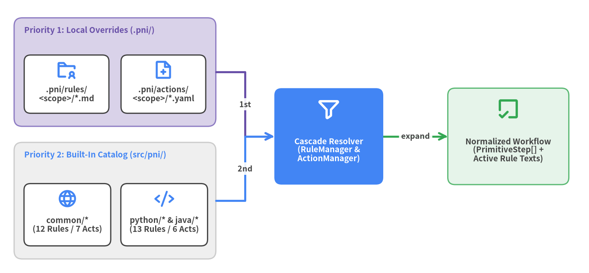
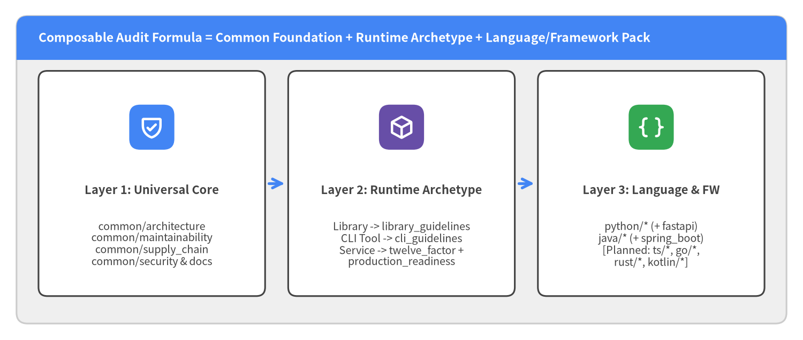

# 1. Orthogonal Taxonomy & Local Cascade Architecture

To scale software health evaluation across diverse runtime archetypes and programming languages without combinatorial duplication, `pni501` organizes both **Rules** (`src/pni/_rules/`) and **Composite Actions** (`src/pni/_actions/`) along two orthogonal axes: **universal engineering governance** versus **language- and framework-specific mechanics**, backed by a deterministic local `.pni/` override cascade.

<figure class="drawlib-image">
  
  <figcaption class="drawlib-caption">Two-Layer Local Cascade (.pni/ Overrides Over Built-In Packages) Across Common, Python, and Java Scopes</figcaption>
</figure>

---

## 1.1 Orthogonal Separation: Runtime Archetype vs. Language Syntax

A recurring anti-pattern in static analysis toolchains is rewriting architectural, security, and operational rules separately for every programming language. In `pni501`, rules are partitioned strictly by **what kind of engineering invariant they govern**:

1. **Universal Standards (`common/*`)**: Govern invariants that hold true regardless of implementation language—such as layered dependency direction (`common/architecture`), SIG unit complexity limits (`common/maintainability`), OpenSSF lockfile and CI token hygiene (`common/supply_chain`), OWASP secret/injection defenses (`common/security`), 12-Factor statelessness (`common/twelve_factor`), Google SRE I/O timeouts (`common/production_readiness`), `clig.dev` CLI ergonomics (`common/cli_guidelines`), public library API contracts (`common/library_guidelines`), and Diátaxis documentation (`common/documentation`).
2. **Language Core Packs (`<lang>/*`)**: Govern syntax-level idioms, compiler/type-checker strictness, package manager manifests, and unit test conventions—such as PEP 621 `pyproject.toml` + `uv.lock` and PEP 484 annotations in `python/*`, or Maven/Gradle wrappers, Generics safety, and JUnit 5 package mirrors in `java/*`.
3. **Framework Overlay Packs (`<lang>/frameworks/*`)**: Govern framework-specific lifecycle and DI patterns—such as `python/frameworks/fastapi` (lifespan context managers, `Depends()`, Pydantic boundary schemas) and `java/frameworks/spring_boot` (constructor injection over `@Autowired` fields, `@ConfigurationProperties`, transaction boundaries).

<figure class="drawlib-image">
  
  <figcaption class="drawlib-caption">Three-Layer Rule & Action Composition: Combining Universal Archetype Governance with Language & Framework Packs</figcaption>
</figure>

---

## 1.2 Scoped Resolution Precedence & CLI Inspection

Both `RuleManager` (`src/pni/_rules/manager.py`) and `ActionManager` (`src/pni/_actions/manager.py`) implement deterministic cascade resolution so teams can customize organizational rules without forking `pni501`:

- **Explicit Scoped IDs (`python/typing`, `common/supply_chain`)**: Resolved by checking `.pni/rules/<scope>/<name>.md` first; if absent, `pni` falls back to the built-in `src/pni/_rules/<scope>/<name>.md`.
- **Unqualified Action IDs in Workflows (`uses: repo_structure_audit`)**: When a workflow declares a top-level `lang: python` (or `lang: java`), unqualified action references automatically search `<lang>/<action_id>.yaml` before falling back to `common/<action_id>.yaml`, checking `.pni/actions/` ahead of built-in `src/pni/_actions/` at each step.
- **Transparent Inspection Commands**: Engineers can inspect which source (`local` vs. `builtin`) wins for every rule and composite action at any time via `pni rules list`, `pni rules show <id>`, `pni actions list`, and `pni actions show <id>`.
