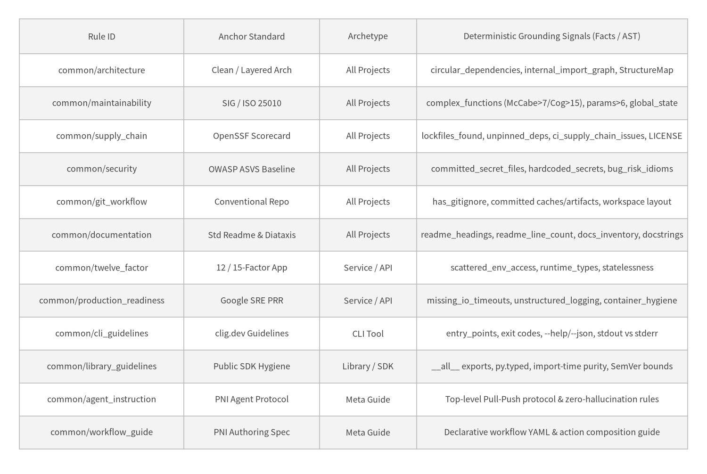
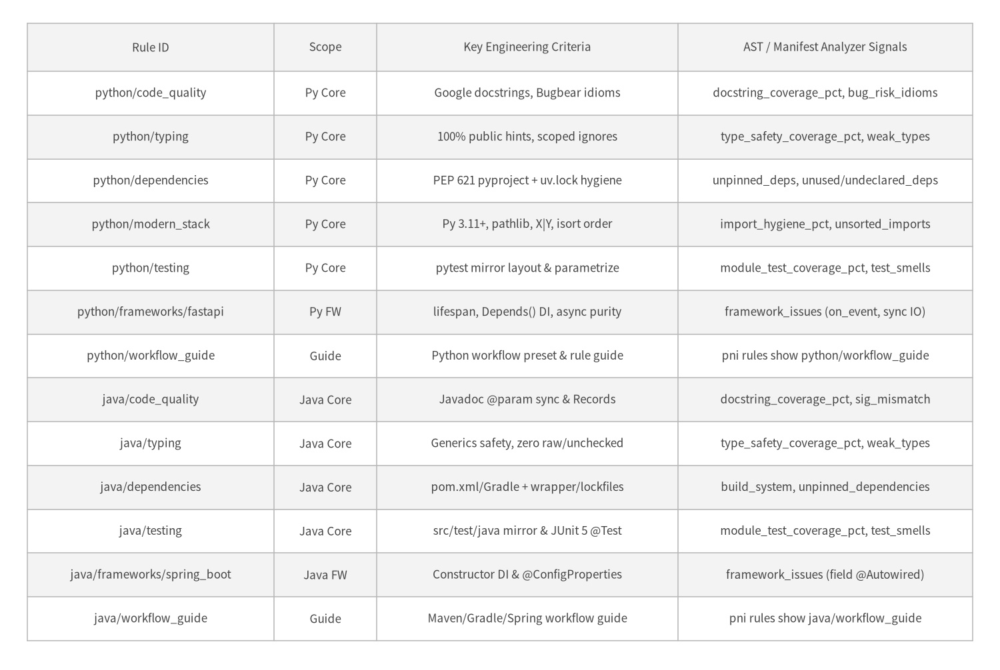

# 2. Implemented Rules Catalog & Deterministic Fact Grounding

`pni501` currently ships **25 built-in Markdown rule files** (`21` evaluation standards and `4` agent/workflow orchestration guides) across `common/`, `python/`, and `java/`. Crucially, every evaluation rule is paired with deterministic static extractors in `ProjectFacts` (`project_inspect`) and `AstFacts` (`ast_analyze`) so AI evaluations are anchored in exact repository evidence rather than unverified LLM impressions.

<figure class="drawlib-image">
  
  <figcaption class="drawlib-caption">Implemented Universal Rules Catalog (common/* — 12 Files): Industry Standards & Deterministic Grounding Signals</figcaption>
</figure>

---

## 2.1 Quantitative Thresholds in Universal Standards (`common/*`)

Each universal audit rule translates external engineering specifications into concrete, auditable checkpoints:

- **SIG / ISO 25010 Maintainability (`common/maintainability`)**: Enforces four quantitative code-health invariants—**Unit Size** (`<= 50` LOC target), **Unit Complexity** (`McCabe <= 7`, `cognitive <= 15`), **Unit Interfacing** (`<= 6` parameters; group larger signatures into typed config/DTO objects), and **Module Coupling** (`0` import cycles and `0` mutable module-level globals).
- **OpenSSF Supply-Chain Hygiene (`common/supply_chain`)**: Verifies committed dependency lockfiles (`uv.lock`, `poetry.lock`, `gradle.lockfile`, Maven wrapper), explicit GitHub Actions `permissions:` blocks, SHA-pinned third-party CI actions, non-root pinned `Dockerfile` base images, `SECURITY.md`, `LICENSE`, and Dependabot/Renovate automation.
- **12-Factor & Google SRE Readiness (`common/twelve_factor`, `common/production_readiness`)**: Flags scattered `os.environ` / `System.getenv` reads outside dedicated settings modules, external HTTP/DB/subprocess calls missing explicit `timeout=` budgets, unstructured `print` / `System.out.println` logging in services, and missing health/graceful-shutdown hooks.
- **CLI & Library Archetypes (`common/cli_guidelines`, `common/library_guidelines`)**: Ensures CLIs separate machine-readable `stdout` from diagnostic `stderr` with non-zero exit codes, and ensures libraries expose explicit public facades (`__all__`), ship `py.typed` markers, avoid import-time side effects, and avoid calling `sys.exit()` inside library routines.

---

## 2.2 Implemented Language & Framework Rules (`python/*` & `java/*`)

Alongside `common/*`, `pni501` implements full static AST analyzer suites (`LanguageAnalyzerSuite` across **8 abstract checker modules**: `imports`, `typing`, `docs`, `quality`, `dependencies`, `testing`, `framework`, and `operational`) for **Python** (via Python `ast` + `ast-grep-py`) and **Java** (via `ast-grep-py`).

<figure class="drawlib-image">
  
  <figcaption class="drawlib-caption">Implemented Python (7 Files) & Java (6 Files) Language and Framework Rules Catalog</figcaption>
</figure>

