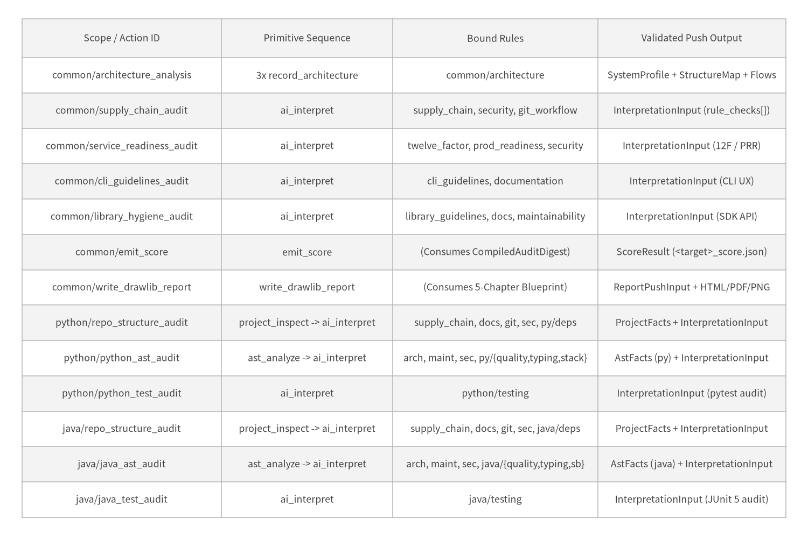
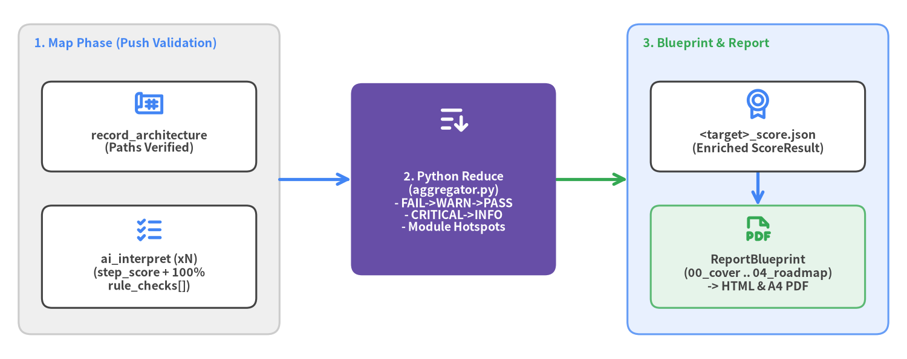

# 3. Implemented Actions Catalog & Deterministic Map-Reduce Pipeline

While **Rules** define declarative evaluation criteria, **Actions** (`src/pni/_actions/`) define executable audit units. `pni501` currently provides **8 canonical `PrimitiveType`s** and **13 built-in Composite Action YAMLs** (`7` universal `common/` actions, `3` `python/` actions, and `3` `java/` actions), orchestrated through a deterministic Map-Reduce-Blueprint pipeline.

<figure class="drawlib-image">
  
  <figcaption class="drawlib-caption">Complete Catalog of All 13 Implemented Built-In Composite Actions (common/*, python/*, and java/*)</figcaption>
</figure>

---

## 3.1 The 8 Canonical `PrimitiveType`s (`base_model.py`)

Every workflow step—whether declared inline via `action:` or expanded from a composite YAML via `uses:`—executes as one of **8 canonical primitives**:

1. **`project_inspect`** *(Deterministic Python)*: Scans manifests (`pyproject.toml`, `pom.xml`, `build.gradle`), lockfiles, CI workflows, Dockerfiles, secrets, README headings, and `docs/` trees into `.pni/cache/<target>_facts.json`.
2. **`ast_analyze`** *(Deterministic Python)*: Runs the 8-dimension `LanguageAnalyzerSuite` (`python` or `java`) to measure exact import hygiene, type coverage, docstring/Javadoc sync, cognitive complexity, coupling cycles, operational timeouts, and test smells.
3. **`run_check`** *(Deterministic Subprocess)*: Executes whitelisted read-only verification commands and captures exit codes and output summaries into `WorkflowFactsBundle.checks`.
4. **`load_rules`** *(Context Injection)*: Injects cascaded rule Markdown documents directly into the step context when standalone rule priming is needed.
5. **`record_architecture`** *(Schema-Grounded AI)*: Records repository-verified `SystemProfile`, `StructureMap` (layers, modules, internal edges), and `ExecutionFlowMap` into `.pni/cache/<target>_architecture.json`, verifying every referenced `path` exists on disk.
6. **`ai_interpret`** *(Schema-Grounded AI Map Step)*: Evaluates active rules against extracted facts and source files. Enforces submission of a numeric `step_score` (`0–100`), explicit `rule_checks` (`pass` / `warn` / `fail` / `not_applicable`) covering **100% of active step rules**, file-verified `findings`, and concrete `action_items`.
7. **`emit_score`** *(Deterministic Reduce + Synthesis)*: Presents the pre-sorted `CompiledAuditDigest` to synthesize `overall_score`, `grade`, and executive rationales, then deterministically merges all sorted `audit_dimensions`, `rule_compliance`, `module_hotspots`, `findings`, `action_plan`, and `metrics_snapshot` into `<target>_score.json`.
8. **`write_drawlib_report`** *(Blueprint-Driven Visual Compiler)*: Generates `.pni/cache/<target>_report_blueprint.json` specifying exact sorted tables, heatmaps, and diagrams for Chapters `00`–`04`, then verifies compiled deliverables (`report.pdf` / `report_html/index.html`) at push time.

---

## 3.2 Action-Driven Map-Reduce & 5-Chapter Blueprint Pipeline

Earlier audit pipelines asked the LLM to remember dozens of rules at the end of a run, causing newly added checks to be omitted from prose reports. `pni501` solves this via **deterministic Python aggregation** (`aggregator.py` and `blueprint.py`):

<figure class="drawlib-image">
  
  <figcaption class="drawlib-caption">Map-Reduce-Blueprint Loop: Per-Action Structured Push -> Python Deterministic Sort -> 5-Chapter Drawlib Spec</figcaption>
</figure>

### Standard Workflow Archetype Recipes

Workflows in `.pni/workflows/*.yaml` compose these 13 actions by project archetype:

- **Library / SDK**: `architecture_analysis` → `repo_structure_audit` → `<lang>_ast_audit` → `library_hygiene_audit` → `<lang>_test_audit` → `emit_score` → `write_drawlib_report`.
- **CLI Application**: `architecture_analysis` → `repo_structure_audit` → `<lang>_ast_audit` → `cli_guidelines_audit` → `<lang>_test_audit` → `emit_score` → `write_drawlib_report`.
- **Service / Web API**: `architecture_analysis` → `repo_structure_audit` → `<lang>_ast_audit` → `service_readiness_audit` → `supply_chain_audit` → `<lang>_test_audit` → `emit_score` → `write_drawlib_report`.
